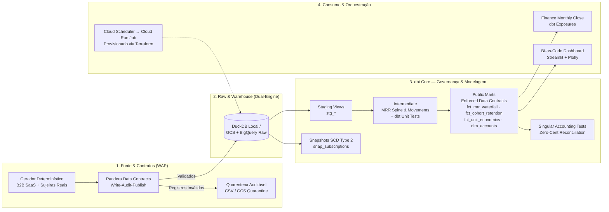
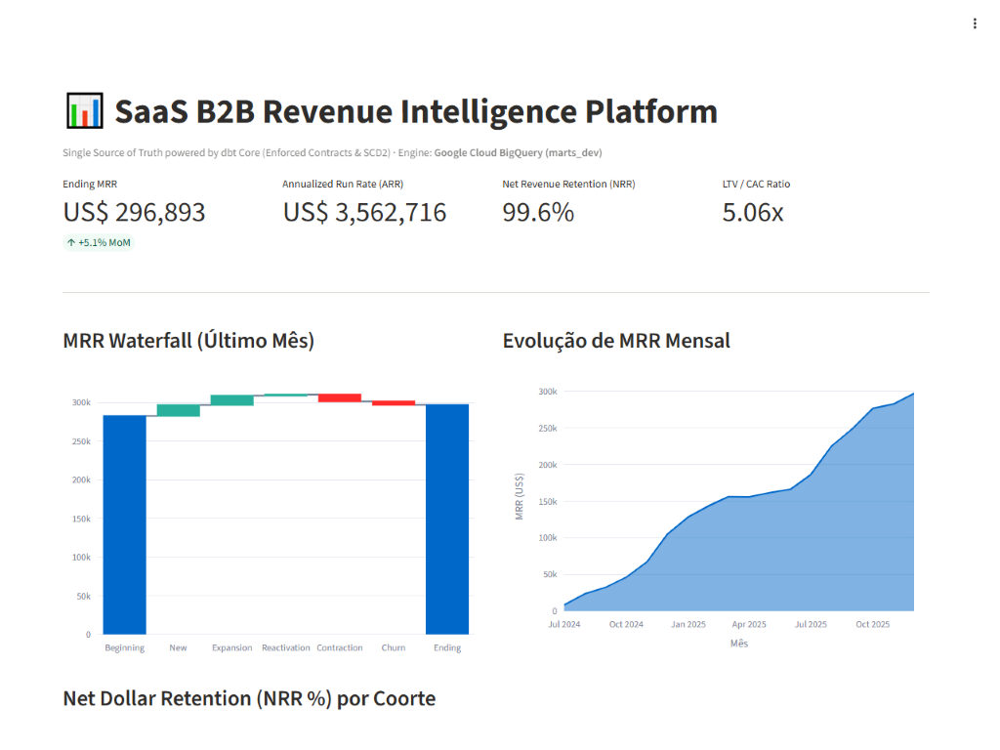

# SaaS B2B Revenue Analytics Platform

[](https://github.com/GabrieelMelo97/saas-revenue-analytics-platform/actions/workflows/ci.yml)


> **Resumo Executivo:** Plataforma de Analytics Engineering ponta a ponta que estabelece a *Single Source of Truth* de receita recorrente para negócios **SaaS B2B** (**MRR Waterfall**, **NRR**, **Cohort Retention** e **LTV/CAC Unit Economics**), unindo **Write-Audit-Publish (Pandera)**, **dbt Core** (SCD Type 2, Data Contracts enforced, dbt Unit Tests e Reconciliação Contábil), **paridade Dual-Engine (DuckDB local custo \$0 + BigQuery na GCP)** e **Infraestrutura como Código modular em Terraform** com orquestração serverless em **Cloud Run Jobs**.

---

## 1. Contexto de Negócio & Problema

- **Cenário:** Em empresas SaaS B2B em crescimento, Financeiro, Produto e Growth frequentemente divergem sobre o **MRR real**, **Net Revenue Retention (NRR)** e **Payback de CAC** devido a mudanças retroativas de planos, faturas duplicadas, registros corrompidos e ausência de contratos de dados.
- **Dor Principal:** Um erro de 2% no cálculo de NRR ou Churn distorce decisões de *budget* de aquisição, metas comerciais e reportes para investidores.
- **KPIs-Alvo & Invariantes Garantidas:**
  - **Reconciliação Contábil Zero-Divergência:** `Beginning MRR + New + Expansion + Reactivation - Contraction - Churn == Ending MRR` validada automaticamente em 100% dos meses.
  - **Confiabilidade na Ingestão (WAP):** registros negativos, órfãos ou duplicados são automaticamente isolados em **quarentena auditável** antes de tocar o warehouse.
  - **FinOps Serverless:** custo operacional de **\$0/mês localmente** e **< US\$ 1,50/mês na GCP** (Free Tier) usando **Cloud Run Jobs + Cloud Scheduler** em vez de Cloud Composer (~US\$ 300/mês).

---

## 2. Arquitetura End-to-End



### Stack Tecnológica

| Camada | Local Parity (Custo \$0) | Cloud Production (GCP) | Motivo da Escolha |
| :--- | :--- | :--- | :--- |
| **Ingestão & Contratos** | Python + Pandera (WAP) | Python + GCS + BigQuery Load | Isola anomalias em quarentena antes da carga |
| **Warehouse** | DuckDB | BigQuery (Particionado + Clustered) | Feedback em segundos no CI + escala serverless na nuvem |
| **Transformação & Qualidade** | dbt Core (`dbt-duckdb`) | dbt Core (`dbt-bigquery`) | SCD2 Snapshots, Enforced Contracts, Unit Tests e Exposures |
| **Orquestração** | Makefile / CLI | Cloud Run Jobs + Cloud Scheduler | Scale-to-zero FinOps (~99% mais barato que Composer) |
| **Infraestrutura (IaC)** | Terraform Validate | Terraform Modular (5 módulos) | Least Privilege IAM, Lifecycle GCS e Budget Alerts |
| **Consumo (BI-as-Code)** | Streamlit + Plotly | Cloud Run + BI Reader SA | Leitura restrita exclusivamente aos `marts` públicos |
| **CI/CD** | GitHub Actions | GitHub Actions | Ruff, pytest, `dbt build`, `terraform fmt/validate` + Trivy |

---

## 3. Decisões Arquiteturais & Trade-offs (ADRs)

Todas as decisões técnicas críticas estão documentadas em [`docs/adr/`](./docs/adr/):

- **[ADR-001](./docs/adr/001-dual-engine-duckdb-bigquery.md):** Por que adotar arquitetura **Dual-Engine (DuckDB + BigQuery)** com macros cross-DB no dbt.
- **[ADR-002](./docs/adr/002-cloud-run-jobs-vs-composer-finops.md):** Por que escolher **Cloud Run Jobs + Cloud Scheduler** em vez de Cloud Composer (análise FinOps).
- **[ADR-003](./docs/adr/003-mrr-waterfall-scd2-and-contracts.md):** Modelagem de **MRR Waterfall**, **SCD Type 2**, **Data Contracts Enforced** e reconciliação contábil automatizada.

---

## 4. Qualidade de Dados, Testes & Resultados Obtidos

- **Write-Audit-Publish (Pandera):** captura automaticamente 100% das anomalias injetadas (MRR negativo, `account_id` nulo e chave duplicada) roteando-as para `data/quarantine/subscriptions_quarantine.csv` com coluna `quarantine_reason`.
- **Testes Python (`pytest`):** cobertura de determinismo, quarentena WAP e idempotência de reexecução.
- **Testes dbt (`dbt build`):**
  - `dbt unit_tests` validando as 6 transições do ciclo de vida SaaS (`new`, `expansion`, `contraction`, `churn`, `inactive`, `reactivation`).
  - `contract: {enforced: true}` e `access: public` na tabela incremental `fct_mrr_waterfall`.
  - Teste singular contábil (`assert_mrr_waterfall_reconciles.sql`) com tolerância de **0,01** em 100% dos meses.
- **Segurança & Qualidade IaC:** `terraform fmt -check`, `terraform validate` e **Trivy Config Scan** (HIGH/CRITICAL) executados em todo Pull Request.

### Preview do Dashboard Executivo (Rodando no Cloud Run lendo do BigQuery `marts_dev`)



---

## 5. Estrutura do Repositório

```text
.
├── .github/workflows/ci.yml       # CI completo: Ruff, pytest, dbt build, Terraform + Trivy
├── docs/adr/                      # Architecture Decision Records (trade-offs de engenharia e FinOps)
├── src/saas_revenue/              # Gerador determinístico, Pandera WAP, ingestão e dashboard BI
├── dbt_project/
│   ├── macros/                    # Macros cross-DB (DuckDB <-> BigQuery)
│   ├── snapshots/                 # SCD Type 2 (snap_subscriptions)
│   ├── models/                    # staging -> intermediate -> marts (contracts & exposures)
│   └── tests/                     # Testes singulares de reconciliação financeira
├── infra/terraform/
│   ├── environments/dev/          # Composição dev + tfvars.example + backend.tf.example
│   └── modules/                   # storage, bigquery, iam, compute, finops
├── tests/                         # Testes unitários, contratos e idempotência
├── Dockerfile                     # Container non-root para Cloud Run Jobs (dbt-bigquery)
├── Makefile                       # Automação em 1 comando
└── pyproject.toml                 # Dependências, Ruff e Pytest
```

---

## 6. Como Executar Localmente (Quickstart — Custo \$0)

Pré-requisitos: **Python 3.10+** e [`uv`](https://docs.astral.sh/uv/) (ou `pip`).

### Linux / macOS (`Makefile`)
```bash
git clone https://github.com/GabrieelMelo97/saas-revenue-analytics-platform.git
cd saas-revenue-analytics-platform
cp .env.example .env
cp dbt_project/profiles.yml.example dbt_project/profiles.yml

make setup
make run          # Ingestão WAP + dbt build completo (snapshots, models, unit & singular tests)
make test         # Pytest (determinismo, quarentena, idempotência)
make lint         # Ruff check + format
make dashboard    # Abre o Dashboard Executivo Streamlit
```

### Windows (PowerShell)
```powershell
git clone https://github.com/GabrieelMelo97/saas-revenue-analytics-platform.git
cd saas-revenue-analytics-platform
Copy-Item .env.example .env
Copy-Item dbt_project\profiles.yml.example dbt_project\profiles.yml

uv venv .venv
uv pip install -e ".[dev]" --python .venv\Scripts\python.exe

.venv\Scripts\python.exe -m saas_revenue.ingest
Push-Location dbt_project
..\.venv\Scripts\dbt.exe build --profiles-dir . --target dev_local
Pop-Location

.venv\Scripts\python.exe -m pytest
.venv\Scripts\streamlit.exe run src\saas_revenue\dashboard.py
```

---

## 7. Deploy na Cloud (GCP + Terraform IaC), Segurança & FinOps

- **Provedor & IaC:** Google Cloud Platform (`GCS`, `BigQuery`, `Artifact Registry`, `Cloud Run Jobs`, `Cloud Scheduler`, `IAM`, `Billing Budget`) + **Terraform >= 1.7**.
- **Security by Design (Least Privilege):**
  - 3 Service Accounts dedicadas (`sa-saas-ingest`, `sa-saas-dbt`, `sa-saas-bi`) — zero chaves JSON estáticas.
  - Buckets com `uniform_bucket_level_access = true`, `public_access_prevention = "enforced"` e versionamento ativo.
  - `sa-saas-bi` possui acesso **somente leitura exclusivamente** ao dataset `marts`.
- **Estimativa de Custo (FinOps):**
  - Em ambiente `dev` de portfólio: **US\$ 0,00 a < US\$ 1,50/mês** (BigQuery Free Tier de 10 GB storage + 1 TB queries/mês; Cloud Run Jobs scale-to-zero; Cloud Scheduler até 3 jobs grátis/mês; GCS Lifecycle automático para Nearline em 30 dias).
  - BigQuery protegido por `maximum_bytes_billed = 1 GB` no `profiles.yml` + particionamento mensal e clustering (`account_id`, `plan_tier`).

```bash
cd infra/terraform/environments/dev
cp terraform.tfvars.example terraform.tfvars   # Preencha seu GCP project_id (arquivo ignorado pelo Git)
terraform init
terraform fmt -check -recursive ../../
terraform validate
terraform plan
# terraform apply    # Provisiona a infraestrutura na GCP
# terraform destroy  # Remove todos os recursos para zerar custos
```

---

## 8. Como Escalar para Produção

- **Ingestão Contínua:** conectar fontes reais (Stripe / Chargebee / Salesforce) via dlt ou Pub/Sub mantendo exatamente os mesmos contratos Pandera e tabela de quarentena.
- **Governança de Dados:** aplicar BigQuery Policy Tags para mascaramento de PII e Workload Identity Federation (OIDC) no GitHub Actions para deploy contínuo sem chaves estáticas.
- **Observabilidade:** integrar Elementary Data ou alertas no Cloud Monitoring sobre falhas de `dbt test`, *source freshness* e anomalias bruscas de Churn/MRR.
